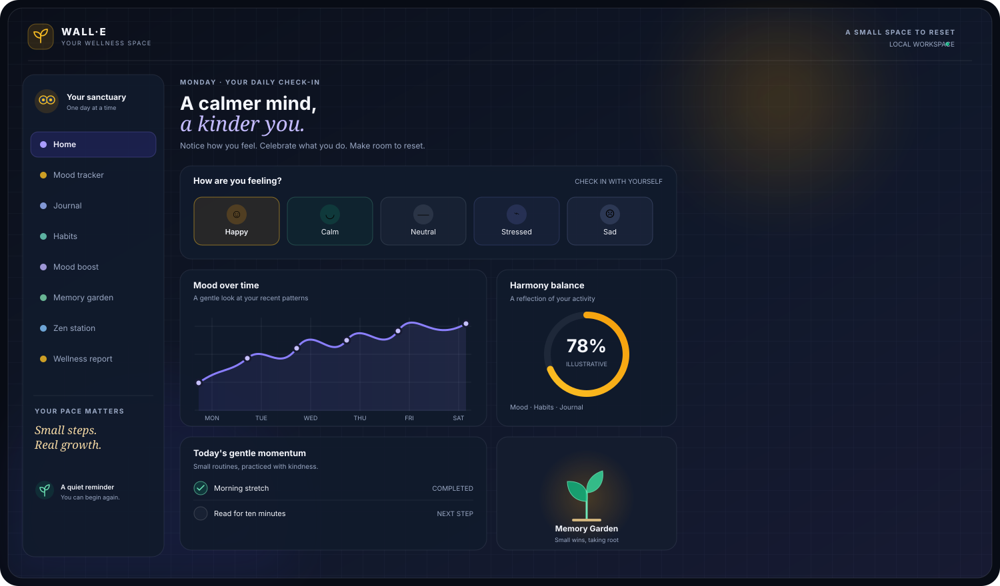

<div align="center">

# 🌱 WALL·E

### **A calmer mind. A kinder you.**

A personal wellness space for checking in with your mood, reflecting without pressure, building gentle routines, and noticing the small things that help you grow.

<p>
  <a href="https://chillingbing648-sketch.github.io/WALL-E/"><strong>OPEN WALL·E ↗</strong></a>
  &nbsp; · &nbsp;
  <a href="https://github.com/chillingbing648-sketch/WALL-E">Explore the source</a>
</p>

<p>
  
  
  
  
  
  
  
</p>

</div>

---

<p align="center">
  
</p>

<div align="center">
  <sub>CHECK IN · REFLECT · RESET · BUILD MOMENTUM · KEEP THE SMALL WINS</sub>
</div>

---

## A little space to come back to yourself

Wellness rarely comes from one big change. WALL·E is designed around smaller, repeatable actions: noticing how you feel, writing down what is on your mind, practicing a habit, taking a mindful pause, and keeping a record of moments worth remembering.

The experience combines a personal dashboard with practical self-reflection tools. Your mood history, journal, habits, and memories inform local summaries and visualizations—giving you a clearer view of your own routines over time.

> **The philosophy:** progress without pressure, reflection without judgment, and a gentle reminder that small steps still count.

## Explore the experience

| Space | What you can do |
|---|---|
| **Home / Sanctuary** | See your current wellness snapshot, daily check-in, Harmony Balance, recent activity, and dashboard analytics. |
| **Mood Tracker** | Log Happy, Calm, Neutral, Stressed, or Sad; add an optional note and review past entries. |
| **Wellness Journal** | Create, edit, browse, and delete personal reflections. |
| **Habit Tracker** | Create routines, mark daily completion, and follow consistency and streaks. |
| **Mood Boost** | Use guided breathing, a meditation timer, gratitude prompts, affirmations, and small interactive resets. |
| **Memory Garden** | Plant a small win, gratitude, warm memory, or reflection and revisit it in a living visual archive. |
| **AI Companion** | Talk with a supportive, intent-matched response system and choose a Friend, Therapist-style, or Motivator tone. |
| **Wellness Insights** | Review locally calculated suggestions and refresh the daily affirmation. |
| **Wellness Report** | Explore a month of mood, habit, and journaling activity, with charts and a downloadable text report. |
| **Zen Station** | Play bundled nature and focus soundscapes, adjust volume, and launch a guided moment with WALL·E. |

## Designed around small actions

### 01 — Notice

Choose one of five moods and optionally write a short note. WALL·E keeps the entries in a date-stamped history that powers the mood distribution, recent trend, and monthly overview.

### 02 — Reflect

Use the journal to get thoughts out of your head and onto the page. Entries can be edited later, so the journal remains a working reflection space rather than a one-way feed.

### 03 — Build gentle momentum

Add personal habits, mark the days you complete them, and track your streaks. Dashboard summaries bring mood, habits, and journaling together in the **Harmony Balance** wellness score.

### 04 — Take a reset

Choose the type of pause that fits the moment:

- **Three Slow Breaths** — a short guided breathing sequence.
- **Notice Your Surroundings** — a sensory 3-2-1 grounding practice.
- **Drop Your Shoulders** — a brief body-awareness reset.
- **Reflect on One Win** — name a small effort worth acknowledging.
- **Wind Down for Sleep** — a gentle end-of-day sequence.

Other tools include 4-7-8 breathing, a meditation timer, gratitude journaling, affirmations, and three tiny-reset interactions: **Calm Dots**, **Gentle Pop**, and **A Little Growth**.

### 05 — Keep what matters

The **Memory Garden** turns small wins, gratitude, warm memories, and reflections into entries in a visual garden. Guided moments can also be carried into the garden, creating a small archive of meaningful actions.

---

## See the patterns, not just the numbers

WALL·E includes interactive visual summaries built with Chart.js.

- **Seven-day mood trend** — view recent changes in recorded mood.
- **Mood distribution** — see how logged moods are represented across the selected history.
- **Weekly habit completion** — compare completed routines.
- **Harmony Balance** — a composite application metric based on activity tracked in the app.
- **Monthly report** — review average mood, mood distribution, habit consistency, journal activity, notable days, and locally generated insight prompts.

These visuals are intended for personal reflection. The Harmony Balance score and generated observations are **not clinical measurements, diagnoses, or validated mental-health assessments**.

## The companion, honestly described

WALL·E's companion is **AI-inspired, not connected to a live AI model**. Its current implementation uses local keyword/intent matching and a curated response library, with selectable conversational styles. Monthly insight cards are also generated from local rules and recorded activity.

There is no configured model API, backend service, or cloud conversation endpoint in this repository. The companion can offer prompts and point you toward the app's tools, but it cannot replace a qualified mental-health professional or emergency support.

---

## Visual & interaction system

WALL·E uses a deep-space foundation with restrained indigo and violet atmosphere, warm amber highlights, and emerald accents for positive or completed states. Its interface combines glass-like panels, soft ambient backgrounds, Playfair Display, Plus Jakarta Sans, and Space Grotesk.

GSAP and ScrollTrigger enhance transitions and selected interactions when available. The app also checks the browser's reduced-motion preference and scales back motion effects when requested.

The design goal is a quiet workspace: enough visual warmth to feel welcoming, enough structure to make the tools easy to find, and no pressure to turn personal wellbeing into a competition.

## How it works

WALL·E is a **static, client-side application** built with HTML, CSS, and vanilla JavaScript.

```text
index.html
   │
   ├── style.css  ──► Design tokens, layout, visual states, responsive UI
   │
   └── script.js  ──► App controller + feature systems
                       ├── Mood System + Analytics
                       ├── Companion + chat history
                       ├── Journal + Habit Systems
                       ├── Mood Boost + guided moments
                       ├── Memory Garden + Tiny Wins
                       ├── Sound System
                       └── Wellness Reports

Browser localStorage ──► Local profiles and saved wellness records
Chart.js / GSAP      ──► Charts and enhanced motion
Bundled audio files  ──► Zen Station soundscapes
```

### Persistence model

The app saves data in browser `localStorage`, organized by the local username for feature data. It does not use a database or server-side account system. Data is therefore tied to the browser and device where it was created; it is not automatically synchronized across devices.

The app includes guarded storage helpers for JSON reads and writes. Browser storage can still be cleared, restricted, or run out of space, so it should not be treated as a reliable long-term backup.

---

## Run locally

No package installation or build step is required.

### Option A — Open the page

Open `index.html` in a modern browser. For more consistent browser storage and asset behavior, use a local static server instead.

### Option B — Start a local server

From the project root:

```bash
# Python 3
python -m http.server 8000
```

On Windows, `py -m http.server 8000` can be used when the `py` launcher is installed.

Then open:

```text
http://localhost:8000
```

The fonts, Chart.js, GSAP, and ScrollTrigger are referenced from external CDNs, so those resources require an internet connection.

## Deploy

WALL·E includes a GitHub Actions workflow at `.github/workflows/pages.yml` that publishes the repository contents to GitHub Pages.

1. Push changes to `main` or run the workflow manually.
2. GitHub Actions uploads the static site.
3. The site is published through the repository's Pages deployment.

Because the application is static, it can also be hosted by another static-site provider. No Node server or database is required.

<p align="center">
  <a href="https://chillingbing648-sketch.github.io/WALL-E/"><strong>Visit the WALL·E experience ↗</strong></a>
</p>

---

## Privacy, security & wellbeing boundaries

A few implementation details matter before using the app with personal information:

- **Local-first records:** mood entries, journal content, habit logs, chat history, and memories are stored in this browser, not synchronized to a WALL·E backend.
- **External assets:** Google Fonts and third-party CDN scripts are requested by the browser. The app does not define an application endpoint that sends your journal or mood records to a server.
- **Local demo accounts:** the sign-in/sign-up flow is a browser-side convenience, not production authentication. Passwords are reversibly Base64-encoded in local storage—not securely hashed—so never reuse a real password or treat the profile as protected access control.
- **Shared devices:** anyone with sufficient access to the same browser profile may be able to access stored data. Avoid entering highly sensitive personal information.
- **Wellbeing use:** WALL·E is a self-reflection and habit-support project, not medical care, diagnosis, therapy, or a crisis-response service. When support is urgent, contact a trusted person or an appropriate local professional/emergency service.

These boundaries are documented so the app's local-first approach is not mistaken for secure, encrypted, or clinical-grade data handling.

## Project structure

```text
WALL-E/
├── .github/
│   └── workflows/
│       └── pages.yml
├── assets/
│   └── walle-readme-hero.svg
├── index.html          # App shell, landing/auth screen, dashboard and feature views
├── style.css           # Design tokens, components, layouts, responsive styling
├── script.js           # Client-side app systems and local persistence
├── Rain.mp3
├── Ocean.wav
├── Forest.mp3
├── Fireplace.m4a
├── Binaural.m4a
├── Delta Waves.mp3
├── White Noise.mp3
└── README.md
```

## Current scope & future work

**Implemented:** browser-local profiles, mood logging and history, dashboard charts, wellness score, companion chat, journal CRUD, habit tracking and streaks, guided breathing, meditation timer, gratitude, affirmations, Tiny Resets, Memory Garden, guided moments, bundled soundscapes, monthly reports, and GitHub Pages deployment.

**Useful next refinements:**
- Replace local demo authentication with a carefully designed, secure auth model only if a backend is introduced.
- Add an explicit data export/import and deletion workflow for local records.
- Expand automated tests for storage corruption, date boundaries, reports, and interactive flows.
- Review accessibility across dialogs, keyboard flows, contrast, and all reduced-motion states.
- Consider optimizing the bundled audio assets to reduce repository and initial-download overhead.

## Credits & license

Built as an educational web-development project by **Harsh Dubey**.

The repository currently does not include a dedicated `LICENSE` file. Add one before granting explicit reuse or redistribution permissions.

---

<div align="center">

### **You don't have to fix everything today.**

Give yourself a moment. Take one small step. Let that be enough for now.

**WALL·E — A calmer mind. A kinder you.**

</div>
